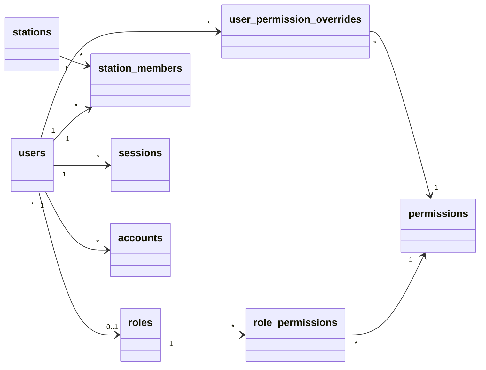
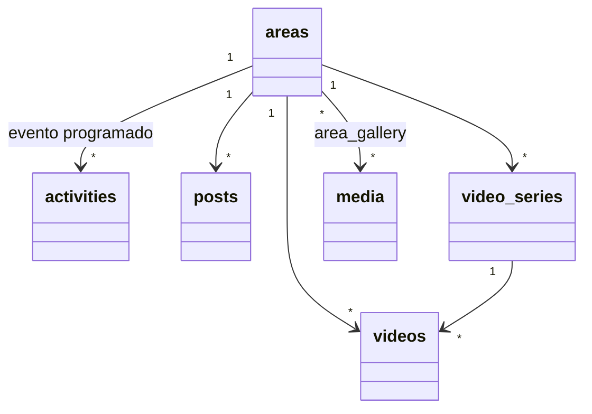
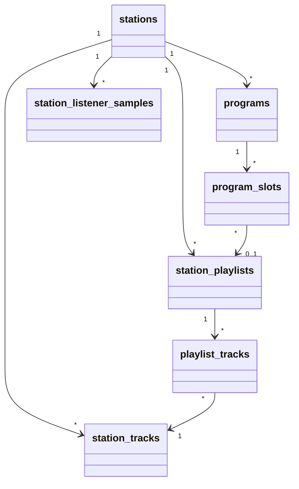

# Base de datos — Ministerio La Luz del Tiempo

> PostgreSQL 16+. 35 tablas en 4 grupos (incluye las 3 de Better Auth). Actualizado: 20/11/2026.
> Convenciones: tablas y columnas en `snake_case` (inglés), PK `uuid` (`gen_random_uuid()`), fechas `timestamptz`, `created_at` / `updated_at` en casi todas.
> Las tablas de autenticación siguen el formato de **Better Auth** (`users`, `sessions`, `accounts`, `verifications`, con `usePlural: true`).

## Índice
1. [Usuarios, roles y permisos](#1-usuarios-roles-y-permisos)
2. [Contenido de la web](#2-contenido-de-la-web)
3. [Radio](#3-radio)
4. [Gestión interna](#4-gestión-interna)
5. [Catálogo de permisos y roles por defecto](#5-catálogo-de-permisos-y-roles-por-defecto)
6. [Reglas de negocio clave](#6-reglas-de-negocio-clave)
7. [Por qué esta estructura](#7-por-qué-esta-estructura)
8. [Futuras mejoras](#8-futuras-mejoras)

---

## 1. Usuarios, roles y permisos

### `users`
| Columna | Tipo | Notas |
|---|---|---|
| id | text PK | Lo genera Better Auth |
| name | text | |
| email | text UNIQUE | |
| email_verified | bool | default false |
| image | text | |
| phone | text | |
| role_id | uuid | NULL = usuario de la app móvil (sin acceso al panel) |
| role_scope | enum `global`/`station` | Copia del scope del rol (para validar con constraints) |
| is_active | bool | default true |
| must_change_password | bool | Para contraseñas temporales |
| last_login_at | timestamptz | |
| created_by_id | text FK → users | |

- FK compuesta `(role_id, role_scope) → roles(id, scope)`: no se puede "mentir" el scope.
- Las estaciones a las que pertenece un operador se guardan en `station_members` (ver abajo), no en `users`.

### `station_members` (operadores por estación)
| Columna | Tipo | Notas |
|---|---|---|
| user_id | text FK → users | ON DELETE CASCADE |
| station_id | uuid FK → stations | ON DELETE CASCADE |
| added_by_id | text FK → users | Quién lo asignó (bitácora) |
| created_at | timestamptz | |

PK compuesta `(user_id, station_id)`. Un usuario puede pertenecer a varias estaciones; una estación puede tener varios operadores.

- Solo los usuarios con rol de scope `station` tienen filas aquí. Un rol global no tiene estaciones.
- Una estación `external` tiene **como máximo un** miembro (trigger). Ver §6.
- Un operador debe tener al menos una estación (se valida en la API al crear o quitar; la base lo refuerza con un trigger).

### `sessions`, `accounts`, `verifications`
Estándar de Better Auth (token de sesión, IP, user agent; contraseña hasheada en `accounts.password`; códigos de verificación).

### `roles`
| Columna | Tipo | Notas |
|---|---|---|
| id | uuid PK | |
| key | text UNIQUE | `superadmin`, `admin`, `editor`, `station_operator` o creados. Formato `^[a-z][a-z0-9_]{1,40}$` |
| name, description | text | |
| scope | enum `global`/`station` | `station` = solo su estación |
| is_system | bool | No se puede borrar ni cambiar de scope |
| is_superadmin | bool | Acceso total. CHECK: solo puede ser `global` |

UNIQUE `(id, scope)` para la FK compuesta de `users`.

### `permissions`
| Columna | Tipo | Notas |
|---|---|---|
| key | text PK | `modulo:accion`, ej. `contenido:editar` (ver §5) |
| module | text | Agrupa las casillas en el panel |
| label | text | Texto que ve el admin |
| super_admin_only | bool | Nunca se asigna a otro rol |
| station_scoped | bool | Aplica solo a la estación del usuario |

El catálogo vive en el código y se sincroniza a esta tabla con un seed idempotente.

### `role_permissions`
`role_id` FK (cascade) + `permission_key` FK (cascade). PK compuesta. Son las casillas marcadas de cada rol.

### `user_permission_overrides`
| Columna | Tipo | Notas |
|---|---|---|
| user_id | text FK | PK compuesta con permission_key |
| permission_key | text FK | |
| effect | enum `grant`/`deny` | Dar o quitar un permiso puntual |
| reason | text | |
| granted_by_id | text FK → users | |

**Permisos efectivos** = permisos del rol + `grant` − `deny`. Después se quitan los `super_admin_only`, y si el rol es `station`, los que no sean `station_scoped`.

---

## 2. Contenido de la web

### `media` (imágenes)
| Columna | Tipo | Notas |
|---|---|---|
| id | uuid PK | |
| storage_key | text UNIQUE | Ruta en disco, ej. `img/2026/11/abc.webp` |
| original_name, mime_type | text | |
| size_bytes | bigint | > 0 |
| width, height | int | |
| alt | text | Accesibilidad y SEO |
| uploaded_by_id | text FK → users | |

Se convierten a WebP y se redimensionan al subir. **Los videos no se suben**: son enlaces de YouTube.

### `people` (equipo, predicadores y autores)
| Columna | Tipo | Notas |
|---|---|---|
| id | uuid PK | |
| name | text | |
| role_title | text | "Pastor", "Administrador", "Predicador" |
| bio | text | Corta (2–3 líneas) |
| photo_media_id | uuid FK → media | |
| whatsapp, email | text | Opcionales |
| social | jsonb | Redes, ej. `{ "youtube": "…" }` |
| show_on_about | bool | Aparece en `/nosotros` |
| sort_order | int | |
| is_active | bool | Se oculta sin borrar |
| user_id | text FK → users, nullable | Si además tiene cuenta en el panel |

### `hero_slides` (carrusel de portada)
| Columna | Tipo | Notas |
|---|---|---|
| id | uuid PK | |
| eyebrow, title, subtitle | text | |
| ghost_words | text[3] | Las 3 palabras grandes de fondo |
| cta_label, cta_url | text | Botón (la URL puede ser interna o externa) |
| image_media_id | uuid FK → media | 16:9 |
| tint | text | Color de acento `#RRGGBB` |
| sort_order | int | |
| is_published | bool | |

### `areas`
| Columna | Tipo | Notas |
|---|---|---|
| id | uuid PK | |
| slug | text UNIQUE | `salud`, `musica`. La página pública es `/areas/salud` |
| name | text | |
| template | enum `hero`/`gallery`/`simple` | Las 3 plantillas |
| summary | text | Frase corta para tarjetas |
| content | text | Qué es, qué hace (HTML saneado) |
| cover_media_id | uuid FK → media | |
| color | text | `#RRGGBB` (CHECK) |
| icon, whatsapp, youtube_playlist_id | text | |
| show_in_menu | bool | |
| sort_order | int | |
| is_published | bool | |
| event_enabled | bool | **Interruptor "Programar evento"** |
| created_by_id | text FK | |

### `area_gallery`
`area_id` + `media_id` (PK compuesta), `sort_order`, `caption`.

### `activities` (escuelas, talleres, campañas, estudios)
| Columna | Tipo | Notas |
|---|---|---|
| id | uuid PK | |
| slug | text UNIQUE | |
| area_id | uuid FK → areas | Opcional |
| type | enum | `vacation_school`, `health_school`, `music_school`, `workshop`, `health_campaign`, `bible_campaign`, `bible_study`, `other` |
| title, summary, content | text | |
| cover_media_id | uuid FK | |
| starts_at / ends_at | timestamptz | CHECK `ends_at >= starts_at` |
| schedule_text | text | "Sábados 15:00 a 17:00" |
| is_virtual | bool | |
| location_name, location_address, map_url, virtual_url | text | |
| registration_type | enum `none`/`whatsapp`/`link` | |
| registration_value | text | CHECK: obligatorio si no es `none` |
| capacity | int | > 0, informativo |
| presenter_person_id | uuid FK → people | Quién dirige la actividad |
| cost | text | "Gratis", "Bs 50 por persona" (texto libre) |
| agenda | jsonb | Horario por día: `[{ "day": "Sábado", "items": ["15:00 Bienvenida", …] }]` |
| is_published, published_at | | |

Índices: `(area_id, starts_at)`, `(is_published, starts_at)`.

### `posts` (noticias)
| Columna | Tipo | Notas |
|---|---|---|
| id, slug, title, excerpt, content | | |
| cover_media_id | uuid FK | |
| area_id | uuid FK | |
| status | enum `draft`/`scheduled`/`published`/`archived` | |
| published_at | timestamptz | CHECK: obligatorio si `scheduled` o `published` |
| author_person_id | uuid FK → people | Autor público (predicador o redactor). No es necesariamente un usuario del panel |
| created_by_id | text FK → users | Quién la redactó en el panel |

### `video_series`
`id`, `slug`, `name`, `description`, `area_id` (**obligatorio**), `youtube_playlist_id`, `sort_order`.
UNIQUE `(id, area_id)` para la FK compuesta de `videos`.

### `videos`
| Columna | Tipo | Notas |
|---|---|---|
| id | uuid PK | |
| youtube_id | text UNIQUE | CHECK `^[A-Za-z0-9_-]{11}$` (solo el ID, no la URL) |
| title, description | text | Vienen de oEmbed |
| duration_sec | int | |
| area_id | uuid FK → areas | **Obligatorio** (todo video pertenece a un área) |
| series_id | uuid, nullable | Opcional. FK compuesta `(series_id, area_id) → video_series(id, area_id)`: la serie debe ser de la misma área |
| is_featured, is_published | bool | |
| published_at | timestamptz | Fecha en YouTube |
| source | enum `manual`/`sync` | Para la sincronización futura |

Miniatura: `img.youtube.com/vi/{youtube_id}/hqdefault.jpg` (no se guarda).

### `live_status` (fila única)
`id` = 1 (CHECK), `is_live`, `platform` (`youtube`/`tiktok`/`facebook`/`radio`), `url`, `title`, `started_at`, `updated_by_id`.
CHECK: si `is_live`, la plataforma y la URL son obligatorias.

---

## 3. Radio

### `stations`
| Columna | Tipo | Notas |
|---|---|---|
| id | uuid PK | |
| slug | text UNIQUE | |
| name, description, genre | text | |
| logo_media_id | uuid FK → media | |
| area_id | uuid FK → areas | Radio Salud → área Salud |
| is_main | bool | Solo una: la radio principal "Radio La Luz del Tiempo" (índice único parcial `WHERE is_main`) |
| kind | enum `own`/`external` | `own` = estación del ministerio (puede haber varias). `external` = de otra radio: **máximo 1** (índice único parcial `WHERE kind = 'external'`) |
| operated_by_name | text | Solo externas: "Operada por Radio Pepito". Se muestra en su página pública |
| visible_in_ministry | bool | Las externas, por defecto no |
| status | enum `active`/`suspended`/`disabled` | |
| sort_order | int | |
| mount_point | text UNIQUE | Mount de Icecast, p. ej. `/salud` (no es una URL del sitio; CHECK de formato) |
| source_password_enc | text | Contraseña de transmisión **cifrada** (AES-GCM en la API) |
| autodj_enabled | bool | |
| bitrate_kbps | smallint | 32–320, default 128 |
| max_listeners | int | 1–2000, default 100 |
| storage_quota_mb | int | **Default 5120 (5 GB), máximo 10240 (10 GB)** |
| storage_used_bytes | bigint | CHECK `<= storage_quota_mb × 1 MB` |
| contact_name, contact_phone, contact_email, notes | text | Responsable de la estación externa |

`bitrate_kbps`, `max_listeners` y `storage_quota_mb` solo los cambia el superadmin.

### `station_tracks` (audios del AutoDJ)
`id`, `station_id` (cascade), `storage_key` UNIQUE, `original_name`, `title`, `artist`, `album`, `duration_sec`, `size_bytes` (> 0), `mime_type`, `uploaded_by_id`.

### `station_playlists`
`id`, `station_id`, `name`, `mode` (`rotation`/`scheduled`), `weight` (1–100), `shuffle`, `is_active`.

### `playlist_tracks`
`playlist_id` + `track_id` (PK compuesta), `position`.

### `programs`
`id`, `station_id`, `area_id`, `name`, `description`, `host_name`, `cover_media_id`, `is_active`.

### `program_slots`
| Columna | Tipo | Notas |
|---|---|---|
| program_id | uuid FK | |
| day_of_week | smallint | 0 = domingo … 6 = sábado |
| start_time / end_time | time | CHECK `end > start` (si cruza la medianoche, se guarda en 2 franjas) |
| is_live | bool | Se espera transmisión en vivo |
| playlist_id | uuid FK | Lo que pone el AutoDJ en ese horario |

### `station_listener_samples`
`station_id` + `sampled_at` (PK compuesta), `listeners`. Se guarda una muestra cada 1–5 minutos, leída de Icecast.

---

## 4. Gestión interna

### `contacts` (oyentes e interesados)
| Columna | Tipo | Notas |
|---|---|---|
| id, full_name, phone, email, city | | |
| country | text | default "Bolivia" |
| source | enum `app`/`web`/`whatsapp`/`radio`/`event`/`other` | |
| status | enum `new`/`contacted`/`following`/`member`/`inactive` | |
| notes | text | |
| assigned_to_id | text FK → users | Quién le da seguimiento |
| consent_at | timestamptz | Cuándo aceptó ser contactado |

### `contact_interests`
`contact_id` + `area_id` (PK compuesta). A qué áreas le interesa.

### `contact_followups`
`id`, `contact_id`, `user_id`, `channel` (`whatsapp`/`call`/`visit`/`email`/`other`), `note`, `next_action_at`.

### `donation_receipt_counters`
`year` PK, `last_number`. Contador **sin huecos** por año.

### `donations`
| Columna | Tipo | Notas |
|---|---|---|
| id | uuid PK | |
| receipt_year + receipt_number | smallint + int | UNIQUE juntos → recibo `2026-0001` |
| contact_id | uuid FK → contacts | |
| donor_name | text | NULL = anónimo |
| donor_contact | text | |
| amount | numeric(12,2) | > 0 |
| currency | enum `BOB`/`USD` | |
| method | enum `cash`/`transfer`/`qr`/`deposit`/`remittance`/`other` | |
| received_on | date | |
| purpose | text | Diezmo, ofrenda, campaña… |
| activity_id | uuid FK → activities | Si es para una campaña |
| reference | text | Nro. de transacción |
| show_name_in_reports | bool | Si no, sale como "Anónimo" en el reporte |
| voided_at, void_reason, voided_by_id | | **No se borran: se anulan**. CHECK: fecha y motivo van juntos |

### `push_devices`
`id`, `expo_push_token` UNIQUE, `platform` (`android`/`ios`), `user_id`, `topics text[]` (`area:<id>`, `station:<id>`, con índice GIN), `app_version`, `is_active`, `last_seen_at`.

### `notifications`
`id`, `title`, `body`, `deep_link`, `image_url`, `target` (`all`/`area`/`station`), `target_area_id`, `target_station_id` (CHECK: coinciden con `target`), `status` (`draft`/`scheduled`/`sending`/`sent`/`failed`), `scheduled_at`, `sent_at`, `recipient_count`, `success_count`, `failure_count`, `created_by_id`.

### `site_settings`
`key` PK → `value jsonb`. Ej.: `contact.whatsapp`, `donate.qr`, `social.youtube`, `social.tiktok`.

### `audit_log`
`id` bigint identity, `user_id`, `action`, `entity`, `entity_id`, `station_id` (para que el operador vea el historial de su estación), `changes jsonb`, `ip`, `user_agent`, `created_at`. Solo se inserta; nunca se edita.

---

## 5. Catálogo de permisos y roles por defecto

**Formato:** `modulo:accion`, igual que en el código (`apps/api/src/lib/permisos.ts`).

**Qué se aplica hoy (Etapa 1):** el código usa permisos agrupados: `panel:acceso`, `usuarios:gestionar`, `logs:ver`, `roles:gestionar`, `superadmin:gestionar`, `contenido:editar`, `donaciones:ver`, `estaciones:todas`, `estacion:propia`, `servidores:configurar`. Esa es la referencia vigente.

**Catálogo objetivo (Etapa 2):** la tabla de abajo es la granularidad a la que se llega cuando cada módulo exista. Un permiso agrupado (`contenido:editar`) se reparte en estos cuando haga falta, sin cambiar los roles.

| Módulo | Permisos |
|---|---|
| Noticias | `posts:view` `posts:create` `posts:edit` `posts:publish` `posts:delete` |
| Áreas | `areas:view` `areas:create` `areas:edit` `areas:delete` |
| Actividades | `activities:view` `activities:manage` `activities:delete` |
| Videos | `videos:view` `videos:manage` `videos:delete` |
| En vivo | `live:manage` |
| Equipo | `people:manage` |
| Imágenes | `media:upload` `media:delete` |
| Estaciones | `stations:view`ᴱ `stations:create` `stations:edit`ᴱ `stations:delete` `stations:autodj`ᴱ `stations:credentials`ᴱ `stations:stats`ᴱ `stations:limits`ˢ `stations:suspend` |
| Programación | `programs:view`ᴱ `programs:manage`ᴱ |
| Donaciones | `donations:view` `donations:manage` `donations:reports` |
| Oyentes | `contacts:view` `contacts:manage` `contacts:export` |
| Notificaciones | `notifications:send` |
| Administración | `users:view` `users:manage` `roles:manage` `settings:manage` `audit:view` `system:manage`ˢ |

ᴱ = de estación (el operador lo tiene solo sobre la suya) · ˢ = solo superadmin

| Rol | Scope | Permisos por defecto |
|---|---|---|
| Superadministrador | global | Todos |
| Administrador | global | Todos menos los ˢ |
| Editor | global | Noticias (sin borrar), áreas (ver/editar), actividades, videos, en vivo, subir imágenes, ver estaciones y programación |
| Operador de estación | station | Solo los ᴱ |

Los roles del sistema no se borran. Sus casillas se pueden ajustar, salvo las del superadmin. Se pueden crear roles nuevos (ej. "Tesorero").

---

## 6. Reglas de negocio clave

| Regla | Dónde se garantiza |
|---|---|
| Un operador tiene al menos una estación; un rol global no tiene estaciones | Trigger + API sobre `station_members`; FK compuesta en `users` para el scope |
| Solo puede existir **una** estación externa en el sistema, y tiene un solo operador | Índice único parcial en `stations` (`WHERE kind = 'external'`) + trigger en `station_members` |
| Cuota del AutoDJ ≤ 10 GB y lo usado ≤ la cuota | CHECK en `stations`. La subida hace `UPDATE … storage_used_bytes + tamaño` en la misma transacción, así que falla sola si se pasa, incluso con subidas simultáneas |
| No se puede bajar la cuota por debajo de lo ya usado | El mismo CHECK |
| Recibos correlativos sin huecos y por año | `donation_receipt_counters` con UPSERT dentro de la transacción |
| Las donaciones no se borran | Anulación con motivo (`voided_at` + `void_reason`) |
| Solo el ID de YouTube, nunca la URL | CHECK de formato en `videos` |
| El área es el padre de todo el contenido (noticias, actividades, series, videos, programas). Una serie y un video siempre pertenecen a un área, y si el video tiene serie, debe ser de la misma área | FK compuestas en `videos` y `video_series` |
| Un área con contenido no se borra: se **archiva** (`is_published = false`) y su contenido queda oculto. Solo se elimina si está vacía; si tiene contenido, el panel ofrece mover el contenido a otra área | `is_published` + FK sin borrado en cascada (`ON DELETE RESTRICT`) en las tablas hijas |
| El slug de un área archivada se reserva y no se reutiliza, para que los enlaces no den error | UNIQUE en `areas.slug`; no se libera al archivar |
| Un área archivada no corta la radio asociada: solo se oculta del sitio | `stations.area_id` no depende de `is_published` |
| Un evento que ya pasó deja de mostrarse | Consulta: `ends_at >= now()` (o `starts_at` si no tiene fin) |
| Solo una fila de "En vivo" | CHECK `id = 1` |
| Permisos de superadmin nunca en otro rol | Se ignoran en el código y el seed los limpia |

---

## 7. Por qué esta estructura

- **Áreas como eje.** Noticias, videos, actividades, estaciones y oyentes se cuelgan de un área. Abrir un área nueva no requiere programar nada.
- **Una sola tabla de actividades.** Escuelas, talleres, campañas y estudios son lo mismo con distinto `type`. Así hay un solo calendario y un solo formulario.
- **Roles en la base, no en el código.** El superadmin arma roles marcando casillas, y las excepciones por usuario evitan crear un rol para cada caso.
- **Las reglas críticas están en Postgres.** Si la API tiene un bug, la base igual impide un operador sin estación, pasarse de la cuota o duplicar un recibo.
- **YouTube para video.** El VPS es de 100 GB y el video lo llenaría en semanas. Solo se guardan IDs.
- **Auditoría desde el día 1.** Con donaciones y varios usuarios, saber quién cambió qué evita problemas.

## 8. Futuras mejoras

| Mejora | Cambio en la base |
|---|---|
| Inscripciones en línea | Tabla `registrations` (actividad, nombre, teléfono, edad, tutor). **Datos de menores: consentimiento del tutor** |
| Sync automático de YouTube | Ya está preparado (`videos.source = 'sync'`, `video_series.youtube_playlist_id`) |
| Podcast en Spotify | `podcast_episodes` (audio en el VPS + feed RSS) |
| Cobro a radios externas | `station_plans` y `station_invoices` |
| Certificados de escuelas | `certificates` (código verificable) |
| Galerías de campañas | `activity_gallery` (igual que `area_gallery`) |
| Estadísticas largas | Resumir `station_listener_samples` por hora y borrar el detalle de más de 90 días |
| Búsqueda en la web | Índice `tsvector` en `posts`, `activities` y `videos` |
| Multi-idioma | Columnas `*_i18n jsonb` (solo si hace falta) |
